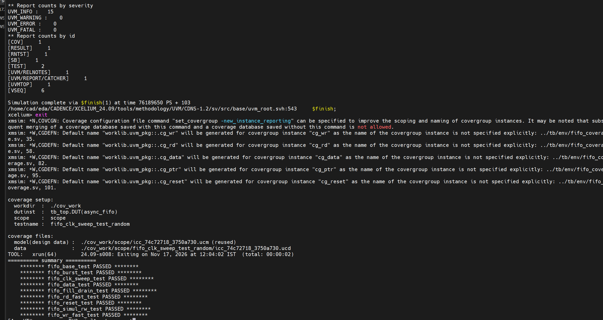
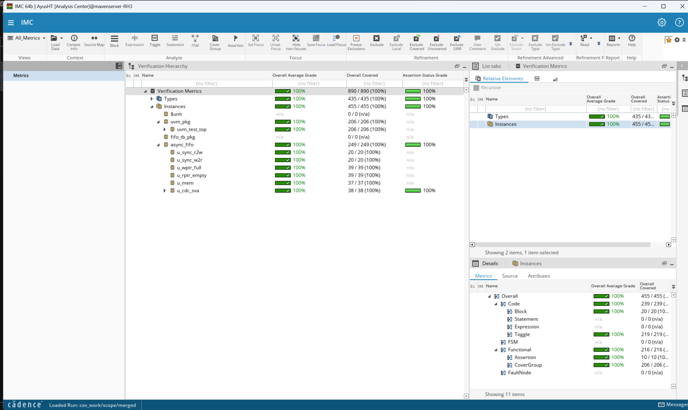
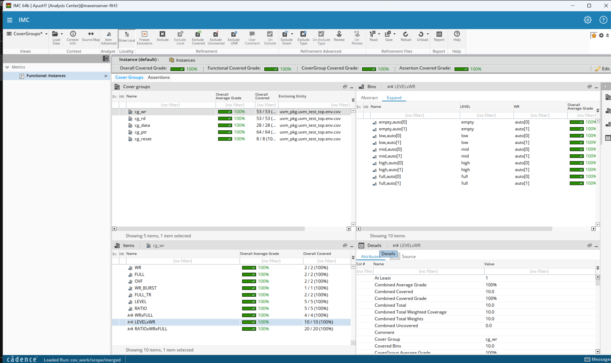

# Asynchronous FIFO — RTL + UVM Verification

Dual-clock FIFO (Gray-code pointers, 2-FF synchronizers) with a full UVM
testbench: two agents (one per clock domain), virtual sequencer, scoreboard,
functional coverage, interface SVA and bound white-box CDC assertions.

## Results (Cadence Xcelium 24.09 + IMC)

* **9/9 tests pass**, 0 UVM errors / fatals
* **100% functional coverage**: 216/216 (206 covergroup bins + 10 assertion covers)
* **100% code coverage** on the DUT: 239/239 (block + toggle)
* **Bug injection:** breaking the Gray full compare (inverting only the MSB) makes
  `fifo_wr_fast_test` fail with ~4,000 errors (`SB_OVF` + `SB_DATA`)

| Regression | Merged coverage | Covergroups / crosses |
|---|---|---|
|  |  |  |

## Design

| Parameter    | Default | Notes                                   |
|--------------|---------|-----------------------------------------|
| `DATA_WIDTH` | 8       |                                         |
| `ADDR_WIDTH` | 4       | depth = 2^ADDR_WIDTH = 16, must be >= 2 |

```
 wclk domain                                rclk domain
 +----------------+   wptr (Gray)   +-----------------+
 | fifo_wptr_full |---> 2FF sync -->| fifo_rptr_empty |
 | bin+gray, full |                 | bin+gray, empty |
 | overflow       |<--- 2FF sync <--| underflow       |
 +----------------+   rptr (Gray)   +-----------------+
         | waddr                            | raddr
         +----------->  fifo_mem  <---------+
              (write @wclk, registered read @rclk)
```

* `rtl/async_fifo.v`: top level, wires the blocks together
* `rtl/fifo_wptr_full.v`: binary + Gray write pointer, registered `full`, `overflow` pulse
* `rtl/fifo_rptr_empty.v`: binary + Gray read pointer, registered `empty`, `underflow` pulse
* `rtl/fifo_sync_2ff.v`: 2-flop synchronizer (Gray buses only)
* `rtl/fifo_mem.v`: dual-clock RAM, registered read port

Pointers are ADDR_WIDTH+1 bits (lap bit). `full` = next Gray write pointer
equals the synced read pointer with its 2 MSBs inverted; `empty` = next Gray
read pointer equals the synced write pointer. Both flags are pessimistic, so
they assert at once and release 2–3 cycles late. Resets are active-low with async
assert, one per domain, asserted together and released per domain.

## Testbench

```
tb_top
 ├── fifo_clk_rst_if   two clocks (periods changeable at run time) + resets
 ├── fifo_wr_if        wclk pins, clocking blocks, write-side SVA
 ├── fifo_rd_if        rclk pins, clocking blocks, read-side SVA
 ├── async_fifo DUT  ◄── bind async_fifo_sva (Gray / pointer / flag CDC checks)
 └── uvm_test_top (fifo_*_test)
      └── env
           ├── wr_agt  (driver, monitor, sequencer)      wclk domain
           ├── rd_agt  (driver, monitor, sequencer)      rclk domain
           ├── vseqr   (wr_seqr + rd_seqr + clk/reset vif)
           ├── sb      scoreboard
           └── cov     functional coverage
```

**Scoreboard.** You can't predict an async FIFO cycle by cycle from outside,
so the scoreboard checks what has to hold however the clocks line up:
in-order data integrity (queue model), no write accepted while the FIFO really holds
DEPTH words, no read accepted while it is really empty, no phantom `rdata`,
and a flush on reset.

**Assertions.**
* Interfaces: overflow/underflow pulse timing, flag values in reset,
  no X out of reset, and `rdata` stable unless a read was accepted.
* Bound into the DUT: every Gray pointer changes ≤1 bit per clock, a pointer moves
  only on an accepted transfer, and `full`/`empty` cannot release unless the
  synchronized opposite pointer moved. Pointer-lap cover properties.

All SVA report through `uvm_error`, so a failing assertion fails the test.

**Coverage** (`fifo_coverage`): write/read enables × full/empty, overflow and
underflow (single and back-to-back), DEPTH-long bursts, flag transitions,
occupancy level × operation, **clock-ratio × operation × flag** (overflow and
underflow under write-faster, read-faster and near-equal clocks), data
patterns, every pointer value on both laps, and occupancy at reset.

## Tests

| Test                   | Clocks (wclk / rclk ns) | What it does                                        |
|------------------------|-------------------------|-----------------------------------------------------|
| `fifo_base_test`       | 10 / 13                 | balanced constrained-random traffic                 |
| `fifo_wr_fast_test`    | 4 / 11                  | write heavy → full, overflow                        |
| `fifo_rd_fast_test`    | 11 / 4                  | read heavy → empty, underflow                       |
| `fifo_fill_drain_test` | 7 / 10                  | directed fill / drain, 3+ pointer wraps             |
| `fifo_simul_rw_test`   | 10 / 10.3               | 100% read+write from empty, half, almost full       |
| `fifo_data_test`       | 8 / 11                  | 00/FF/55/AA, walking 1/0, all 256 values            |
| `fifo_burst_test`      | 9 / 6                   | random bursts and gaps on both sides                |
| `fifo_reset_test`      | 10 / 7                  | reset at full / partial / empty and mid-traffic     |
| `fifo_clk_sweep_test`  | changes 6×              | clock ratio swept during the run                    |

Each test only sets the clock periods and swaps the virtual sequence through a
factory type override. The env never changes.

## Running

```
cd sim
make run     TEST=fifo_wr_fast_test               # SIMULATOR=xcelium (default) | questa | vcs | verilator
make run     TEST=fifo_reset_test SEED=1234       # replay a seed
make run     TEST=fifo_base_test ARGS="+WCLK_NS=5 +RCLK_NS=9 +NUM_CYCLES=20000"
make regress                                      # all 9 tests
make report                                       # merged coverage (IMC / vcover / urg)
```

Free flow (no coverage): Verilator ≥ 5.036 with
[chipsalliance/uvm-verilator](https://github.com/chipsalliance/uvm-verilator):
`make run SIMULATOR=verilator UVM_HOME=<path>/uvm-verilator/src` (needs `z3` on PATH for
`randomize()`). The full 9-test regression passes on Verilator 5.048.

## Layout

```
rtl/                  async FIFO RTL (Verilog-2001)
tb/fifo_defs.svh      width / depth
tb/intf/              clock-reset, write and read interfaces (+ SVA)
tb/sva/               bound CDC assertions
tb/agents/wr_agent/   item, cfg, driver, monitor, agent, sequences
tb/agents/rd_agent/   item, cfg, driver, monitor, agent, sequences
tb/env/               env cfg, scoreboard, coverage, virtual sequencer, env
tb/seq/               virtual sequences
tb/test/              tests, package, tb_top
sim/Makefile
docs/                 regression and IMC coverage screenshots
```
